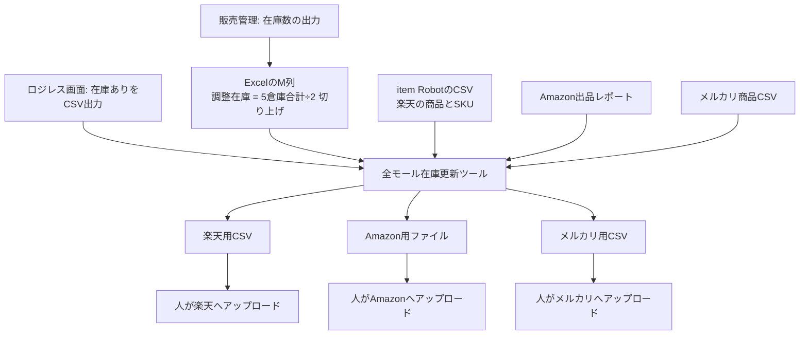
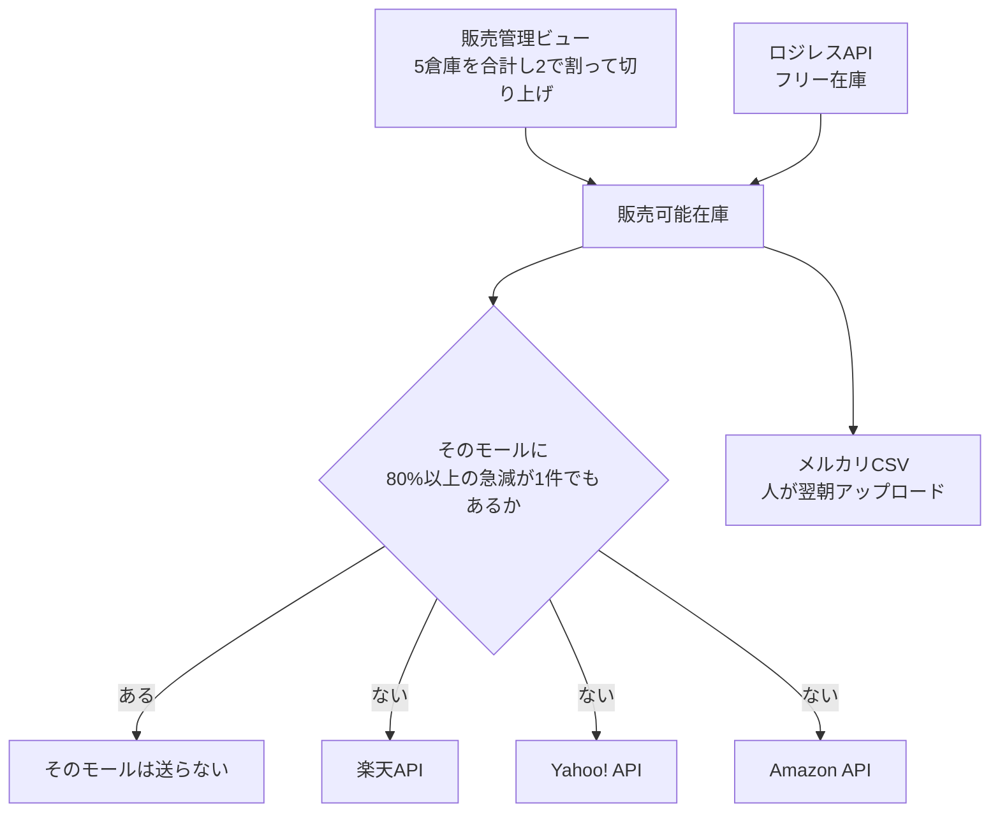

# 在庫反映の流れ（既存と新規）

記録日: 2026-09-29

この文書は、モール全体を比べた検討メモである。2026-09-29 に実装範囲を Amazon だけへ絞った。実装する範囲は `docs/夜間在庫更新_仕様.md` が優先する。楽天・Yahoo!・メルカリは、このメモの検討どおりには進めていない。

## 毎日変わるものと、たまにしか変わらないもの

在庫更新には、別種の情報が2つある。

| 種類 | 中身 | 変わるタイミング |
|------|------|------------------|
| 今夜の在庫数 | 卸の倉庫在庫、ロジレスのフリー在庫、モールに今載っている数量 | 毎日 |
| 商品の対応 | モールの商品番号・SKU番号が、どのWebCDか | 商品の追加、廃止、色やサイズの追加、SKU番号の変更のとき |

既存の手作業は、この2つを同じCSVに入れている。夜間ジョブでは、在庫数は毎回取り直し、商品の対応だけを別扱いにする。

## 既存の流れ

担当者が、毎回同じ順でファイルを作り、モールの管理画面へ上げる。

ツールが計算に使うファイルは次のとおり。

| 入力 | 誰が作るか | ツールが読むもの |
|------|------------|------------------|
| 卸在庫のExcel | 販売管理の「在庫数の出力」のあと、M列の式 | 最新日付シートのWebCDと調整在庫 |
| ロジレスCSV | ロジレス画面でエクスポート | 商品コードとフリー在庫 |
| ir-item / ir-selection / ir-itemsub | item Robotから出力 | 楽天の商品番号、システム連携用SKU番号、ファイルに書いてある在庫数 |
| Amazon出品レポート | セラーセントラルから出力 | 出品者SKUと、ファイルに書いてある数量 |
| メルカリ商品CSV | メルカリから出力 | SKUと、ファイルに書いてある在庫数 |

販売可能在庫は「調整在庫＋ロジレスのフリー在庫」。SKU番号からWebCDへの変換は `parse_sku`。一致しないSKUは、ファイルに書いてあった在庫数のまま残す。

Yahoo!用のファイルはこのツールでは作らない。Yahoo!の在庫は、この流れの外で扱っている。

急減（前回比80%以上）は警告として一覧に出る。ファイル自体は作られ、止めるかどうかはアップロードする人が見る。

## 新規の流れ

同じ計算を、夜間にサーバーで行う。楽天・Yahoo!・AmazonはAPIで数量を送る。メルカリはCSVを置くところまで。

| 入力 | 既存 | 新規 |
|------|------|------|
| 卸の調整在庫 | ExcelのM列 | サーバーがビューから計算。Officeは使わない |
| ロジレス | 画面からCSV | API |
| 楽天へ出すもの | item Robot用CSVを人が上げる | 在庫API 2.0 で数量を送る |
| Yahoo!へ出すもの | このツールの対象外 | 在庫更新APIで数量を送る |
| Amazonへ出すもの | テンプレートを人が上げる | 出品者出荷の数量をAPIで送る |
| メルカリへ出すもの | CSVを人が上げる | CSVを作るところまで。APIは呼ばない |
| 急減 | 警告を見て人が判断 | 1件でもあれば、そのモールは自動では送らない |
| 失敗の連絡 | 人が画面で気づく | Chatwork |

## 分かりにくかった箇所（商品の対応）

既存では、楽天用CSVとAmazon出品レポートが「対応」と「いまの在庫数」を同時に持っている。

例。item Robotの選択肢CSV（2026-09-04出力）の1行:

- 商品コード `532524`
- サイズ `4L`、色 `ワイン（S～3Lまで）`
- 楽天のシステム連携用SKU番号 `532524-1`
- その行の在庫数 `5`

ツールはこのファイルから、SKU `532524-1` をWebCD `532524` と知り、同時に「前回在庫は5」とも知る。

このファイルを毎日出し直さないと、次が起きる。

- 新しく出品した商品は、ファイルに無いので更新されない。
- 廃止したSKUがファイルに残っていると、存在しない番号へ数量を書こうとする。
- 急減の比較が、ファイルを出した日の在庫数との比較になる。9月4日のCSVなら、9月29日のモール在庫とは比べていない。

新規では、この2つを分ける。

| | 既存 | 新規 |
|--|------|------|
| 今夜の卸在庫・ロジレス在庫 | 人がCSVとExcelを置く | ジョブが取得する |
| モールに今載っている数量（急減の比較用） | CSVに書いてある在庫数 | 送信直前にモールAPIから読む |
| どのSKUがどのWebCDか | 人が出したCSVのSKU番号を `parse_sku` で解釈 | ここだけ未決。下のAかB |

未決の選択肢は次の2つである。在庫の計算式はどちらも同じ。

**A. 対応表は人が差し替える**

- 今と同じCSV（楽天の item Robot 出力、Amazonの出品レポート）を、商品を追加・廃止・SKU変更した日だけ新しいものに置き換える。
- 夜間ジョブはそのCSVからSKU番号だけを読む。CSVの中の在庫数は前回数量に使わない。
- 毎日の作業は無くなる。商品マスタを変えた日だけ、今と同じ出力が残る。

**B. 対応表も毎晩APIで読む**

- 楽天の在庫APIとAmazonの出品APIから、掲載中のSKU番号をその夜に取る。
- 人がCSVを差し替える作業は無い。
- SKU番号が `parse_sku` でWebCDに変換できない商品は、その夜は送らない。モール側の数量は残る。

## 選択肢SKU

1つの商品ページに、色やサイズが複数あるときの「その1種類」につく番号である。商品そのものの番号とは別である。

商品 `000063` を例にする。ページは1つで、色が3つある。

| 色 | Yahoo!の選択肢SKU |
|----|-------------------|
| ピンク | `000063-1` |
| イエロー | `000063-2` |
| ブルー | `000063-3` |

モールは、ピンクを1個売ったときに、イエローの在庫まで減らさないよう、色ごとに番号を分けている。この番号が選択肢SKUである。

在庫の計算に使うWebCDは、この番号と一致するとは限らない。同じ選択肢CSVで、Yahoo!の選択肢SKUが `001409-1`（色はブルー）の行は、楽天のシステム連携用SKU番号が `209204` である。倉庫在庫を引く対象は `209204` の方である。

2026-09-04の選択肢CSVでは、Yahoo!の選択肢SKUが「6桁-連番」の行が575件ある。そのうち91件は、システム連携用SKU番号が、商品コードとも選択肢SKUとも違う番号だった。

## 毎晩モールAPIから対応を読むリスク

利便性は高い。商品を追加した翌朝から、人がCSVを差し替えなくても更新対象に入る。リスクは次のとおり。

1. モールAPIが返すのは、そのモールの番号である。Yahoo!なら選択肢SKU（`001409-1`）であり、在庫の本体であるシステム連携用SKU番号（`209204`）は返らない。選択肢SKUをWebCDとして計算すると、別商品の在庫を書く。上の91件がこれに当たる。
2. 楽天の在庫APIが返すSKU管理番号は、多くの行でシステム連携用SKU番号と同じである。楽天はYahoo!よりこのリスクが小さい。ただし、6桁に見えるだけの店内番号をWebCDと誤解する余地は残る。
3. Amazonの出品APIは、出品者SKUを返す。今のツールが読んでいる出品レポートと同じ種類の番号である。あわせて、手作業のレポートには出てこない親SKUやFBA在庫も返りうる。更新してよいのは、今と同じ出品者出荷のSKUだけである。
4. 一覧の取得が途中で切れると、取れなかった商品は今夜更新されない。仕様どおり「一覧に無いSKUは数量を変えない」なら、在庫が0になる事故にはならない。取れなかった分は、モール上の数量が古いまま残る。一覧が欠けたモールは、その夜は送らない、にしないと、欠けに気づかず一部だけ更新される。
5. 人がモール上で手入力した数量も、SKU番号がWebCDに変換できるなら毎晩上書きされる。
6. 全件取得は時間と回数の制限を受ける。楽天は広い条件だと件数超過で失敗した実績がある。Yahoo!は1秒に1回程度である。3:00開始で4:00までに終わらない場合は、そのモールを送らず失敗として扱う。

楽天とAmazonを毎晩APIで読み、Yahoo!の対応だけは選択肢CSVの「選択肢SKU」と「システム連携用SKU番号」の組を人が差し替える、という分け方もできる。

## 枝番

`532524-1` や `543555-1` の `-1` は、別の商品コードではない。1つの商品に色やサイズが複数あるとき、選択肢ごとにモール上の番号を分けるための連番である。

在庫ツールの規則では、`123456-1` はWebCD `123456` として扱い、枝番は在庫の割り算にも掛け算にも使わない。同じ販売可能在庫を、その枝番すべてに書く。

実例:

| 場所 | 番号 | 意味 |
|------|------|------|
| 楽天の選択肢CSV | `532524-1` | 商品 `532524` のサイズ4L・色ワイン |
| 楽天の選択肢CSV | `532524-2` | 同じ商品のサイズ5L・色ワイン |
| Yahoo!の商品 `543555` | `543555-1` | カラー ベージュ |
| Yahoo!の商品 `543555` | `543555-2` | カラー ピンク |
| Yahoo!の商品 `543555` | `543555-3` | カラー グレー |
| Yahoo!の選択肢SKU | `000063-1` | ピンク |
| Yahoo!の選択肢SKU | `000063-2` | イエロー |

枝番が付く理由は、モールが「色・サイズの組み合わせごとに別のSKU番号」を要求するためである。連番にしているので、先頭の6桁から元の商品コードが分かる。

注意が1つある。Yahoo!の選択肢SKUが `001409-1` の行で、楽天のシステム連携用SKU番号は `209204` になっている。この行は、枝番を外した `001409` と、在庫の本体であるWebCDが一致しない。枝番は店内の選択肢連番であり、在庫を引くWebCDそのものではない場合がある。
